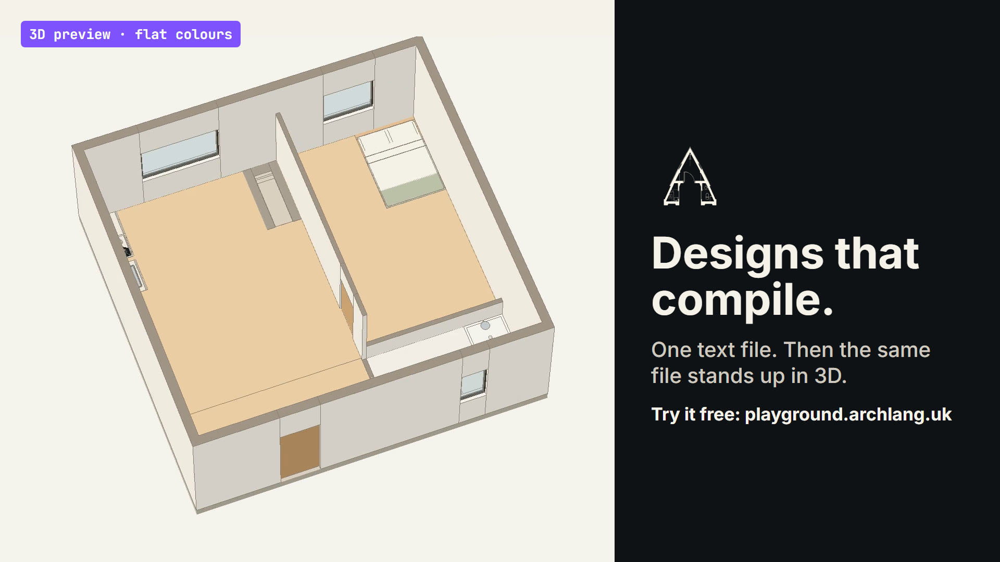

# film-archlang-2d-3d

A feature explainer film for [ArchLang](https://github.com/ChanMeng666/archlang): one `.arch` text
file becomes a dimensioned floor plan that checks itself, then a 3D preview. Made with Remotion,
with every drawing compiled by the real `@chanmeng666/archlang` and every 3D frame produced by
`@chanmeng666/archlang-3d`. English voice-over in the maker's own cloned voice (about 196 s) with
English subtitles; the film is for English-speaking viewers only. S9 is a labelled reenactment of an
agent session whose every command and output is a real run of the pinned CLI.

<!-- FILM: archlang-plan-to-3d -->


https://github.com/user-attachments/assets/879a4b71-415e-4848-a4af-db9c879d6a71




**Watch on YouTube:** [youtu.be/oCg3tBTlVvI](https://youtu.be/oCg3tBTlVvI) · **30 s Short:** [youtu.be/fBV-tr0gLuU](https://youtube.com/shorts/fBV-tr0gLuU) · **More films:** [chanmeng.org/films](https://chanmeng.org/films)

**Watch:** the [v1.0.0 release](https://github.com/ChanMeng666/film-archlang-2d-3d/releases/tag/v1.0.0)
holds the 196 s film (1080p, English subtitles), the 30 s cuts in 16:9 and 9:16, and the poster.
**Try ArchLang:** [playground.archlang.uk](https://playground.archlang.uk) or `npx @chanmeng666/archlang`.

- What the film says and why: [`docs/creative-brief.md`](docs/creative-brief.md)
- Scene by scene, with its captions: [`docs/storyboard.md`](docs/storyboard.md)
- How it is built, as cards: [`docs/build-plan.md`](docs/build-plan.md)
- What happened while building it: [`docs/production-log.md`](docs/production-log.md)

## Commands

```bash
npm install
npm run bake       # compile, lint, describe, finish, export, 3D build → public/baked, data/facts.json
npm run capture    # Playwright captures of the playground and archlang3d replays → public/captures
npm run audio      # fetch music + SFX, check SHA-256
npm run vo         # English voice-over (owner's cloned voice, ElevenLabs eleven_v4), cached by hash; needs .env
npm run vo -- --dry  # what would be sent and its character count; spends nothing
npm run gates      # copy gate (banned words, unfilled slots) + facts gate + logo hash
npm run studio     # Remotion Studio
npm run preview    # half-scale English master → out/preview-en.mp4
npm run review-stills  # one half-scale still from the middle of each scene → out/review/
npm run loudness -- out/preview-en.mp4  # EBU R128: integrated LUFS and true peak
npm run render:en  # full 1080p English master (heavy: one render at a time)
npm run render:cut30   # 30 s cut, 16:9
npm run render:cut30v  # 30 s cut, 9:16 (laid out again for vertical)
npm run poster     # out/poster-16x9.png + out/thumb-1280x720.png
npm run srt        # out/archlang-2d-3d-en.srt and one SRT per cut
```

## Licence

- **Code:** MIT ([LICENSE](LICENSE)). ArchLang examples follow the ArchLang repo's MIT licence.
- **Films, subtitles, poster:** CC BY 4.0 ([LICENSE-MEDIA.md](LICENSE-MEDIA.md)). Credit: "ArchLang,
  from plan to 3D, a film by Chan Meng".
- **Not covered:** the music and effects keep their own licences ([audio/CREDITS.md](audio/CREDITS.md)),
  and the voice is Chan Meng's own (an ElevenLabs clone) and may only be used as part of the
  films. The ArchLang name and logo identify the project (the logo is the official mark, copied byte
  for byte, recolour only). The generated voice clips stay out of git (`audio/vo/`), and so does
  the API key (`.env`).
